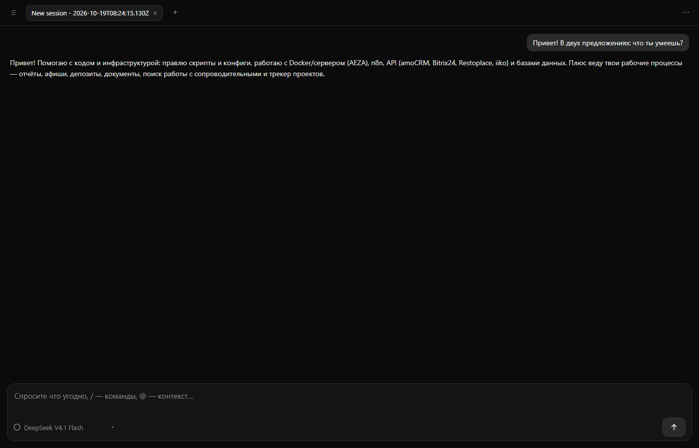
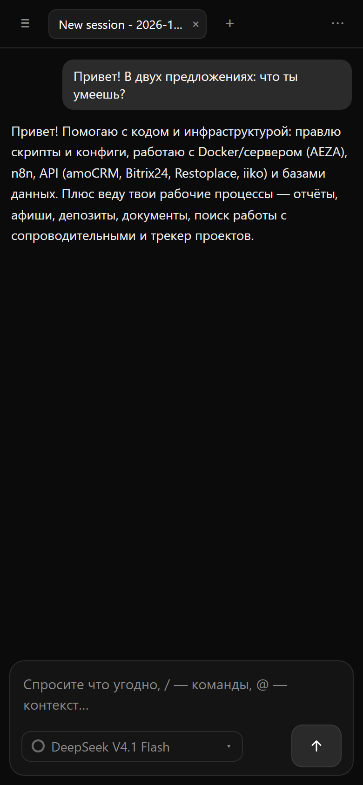

# OpenCode PWA Mob

**Mobile PWA client for [opencode](https://opencode.ai).**

opencode is a terminal AI agent. This project is a compact browser UI for it: install it on a VPS, open it from your phone, and talk to the agent that works in your project.

> Коротко: opencode — это CLI/TUI. Здесь — компактный PWA-клиент к `opencode serve`: чат, сессии, стриминг, лог инструментов, статусы, выбор модели и стоп. Заточен под телефон, но работает и на ПК.

## Скриншоты

Десктоп:



Мобильный:



---

## Зачем это, если у opencode есть `opencode web`

У opencode есть официальный веб-интерфейс (`opencode web`). Этот проект — не замена, а **мобильный/компактный клиент** к тому же серверу:

- PWA-вёрстка и крупные тач-кнопки, нормальная работа с экранной клавиатурой;
- компактный лог инструментов («Оболочка», «Редактировать», «Читать») с diff `+N −M`;
- статусы «Размышление / Выполнение / Ответ / Работа / Сжатие чата / Ошибка / Остановлено»;
- быстрый выбор модели и кнопка «Стоп»;
- легко ставится на VPS и закрывается паролем/reverse-proxy.

Если вам нужен полный официальный веб-интерфейс — используйте `opencode web`. Если нужен лёгкий чат с телефона — этот проект.

## Возможности

- чат с агентом через `opencode serve`;
- список сессий и продолжение диалога;
- потоковый вывод (SSE);
- лог инструментов и diff;
- статусы выполнения и стоп;
- выбор модели;
- `/` — команды и навыки opencode;
- мобильная вёрстка, тёмная тема;
- **PWA**: манифест, service worker, установка на телефон (нужен HTTPS).

## Архитектура

```
Браузер (SPA)
   │  HTTP + SSE
   ▼
server.mjs  (Basic auth, прокси, стриминг)
   │  HTTP API opencode
   ▼
opencode serve :8888
   │
   ├── DeepSeek / OpenAI / Anthropic / Ollama …
   └── инструменты (bash, edit, read, …)
```

`server.mjs` не хранит данные: сессии и сообщения живут в opencode.

---

## Быстрый старт на VPS (Docker)

Подробная пошаговая инструкция (Docker, консольный opencode, внешний сервер): [docs/INSTALL.md](docs/INSTALL.md).

```bash
git clone https://github.com/govorovteam-spec/opencode-pwa-mob.git
cd opencode-pwa-mob
bash scripts/setup.sh
```

Дальше — откройте `http://<IP>:3000`.

### Ручной вариант

Требования: VPS с Docker + Docker Compose, желательно домен.

1. Скопируйте `.env`:

```bash
cp .env.example .env
```

```env
OPENCODE_PASSWORD=длинный-пароль-для-opencode
WEB_USER=admin
WEB_PASSWORD=пароль-для-входа-в-веб
```

2. Создайте `opencode-config/opencode.json` — провайдеры и модели:

```json
{
  "provider": {
    "deepseekai": {
      "npm": "@ai-sdk/openai-compatible",
      "name": "DeepSeek",
      "options": {
        "baseURL": "https://api.deepseek.com/v1",
        "apiKey": "{env:DEEPSEEK_API_KEY}"
      },
      "models": {
        "deepseek-chat": { "name": "DeepSeek Chat" }
      }
    }
  },
  "model": "deepseekai/deepseek-chat"
}
```

Ключи можно положить в `.env` (и пробросить в контейнер) или использовать `opencode auth login`. Подробнее — [docs.opencode.ai](https://opencode.ai/docs/providers/).

3. Запустите:

```bash
docker compose up -d --build
```

- `web` — клиент на `:3000`;
- `opencode` — `opencode serve` на внутреннем `:8888` (наружу не публикуется).

4. HTTPS (рекомендуется) — Caddy:

```caddy
chat.example.com {
    reverse_proxy 127.0.0.1:3000
}
```

Для SSE отключите буферизацию (в nginx: `proxy_buffering off;`).

## Подключение к внешнему opencode

Если `opencode serve` уже работает на другом хосте:

```bash
OPENCODE_URL=http://192.168.1.10:8888 \
OPENCODE_PASSWORD=... \
WEB_USER=admin WEB_PASSWORD=... \
node server.mjs
```

Или в `docker-compose.yml` уберите сервис `opencode` и задайте `OPENCODE_URL`.

`opencode serve` должен быть запущен с `OPENCODE_SERVER_PASSWORD` (Basic auth, пользователь `opencode`).

## Установка opencode без Docker

```bash
# официальный установщик
curl -fsSL https://opencode.ai/install | bash

# или npm
npm install -g opencode-ai

# или официальный Docker-образ
docker run -it --rm ghcr.io/anomalyco/opencode
```

Скрипт из репозитория:

```bash
bash scripts/install-opencode.sh
```

Запуск сервера:

```bash
OPENCODE_SERVER_PASSWORD=... opencode serve --port 8888 --hostname 0.0.0.0
```

## Переменные окружения

| Переменная | Назначение | По умолчанию |
|---|---|---|
| `PORT` | порт веб-клиента | `3000` |
| `OPENCODE_URL` | адрес `opencode serve` | `http://127.0.0.1:8888` |
| `OPENCODE_PASSWORD` | пароль opencode (Basic, user `opencode`) | — |
| `WEB_USER` | логин веб-интерфейса | `admin` |
| `WEB_PASSWORD` | пароль веб-интерфейса (Basic auth) | — (без пароля) |

## API

| Метод | Путь | Описание |
|---|---|---|
| GET | `/api/sessions` | список сессий |
| GET | `/api/messages?session=ID` | сообщения сессии |
| POST | `/api/send` | `{session?, text, model?}` — отправить запрос |
| POST | `/api/model` | `{session, providerID, id}` — сменить модель |
| POST | `/api/stop` | `{session}` — прервать генерацию |
| GET | `/api/models` | доступные модели |
| GET | `/api/menu` | команды и навыки |
| GET | `/api/stream?session=ID` | SSE-поток событий |

## Безопасность

- **Не выставляйте `opencode serve` в интернет напрямую.**
- Веб-клиент закрыт Basic auth; для публичного доступа — HTTPS через reverse-proxy.
- Клиент рассчитан на одного пользователя: многопользовательских ролей и изоляции сессий нет.

## Ограничения

- API opencode может меняться между версиями.
- SSE требует отключённой буферизации в reverse-proxy.
- Нет загрузки файлов и голосового ввода (пока).

## Лицензия

MIT — см. [LICENSE](LICENSE).

